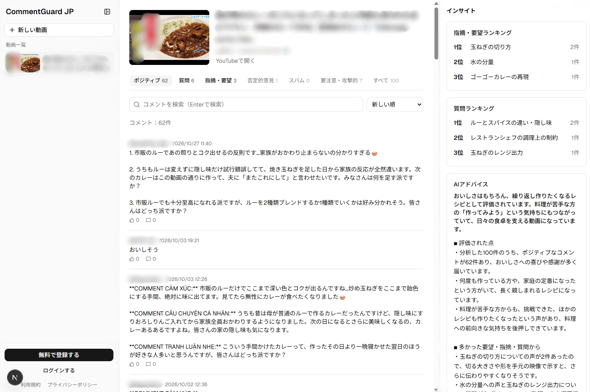
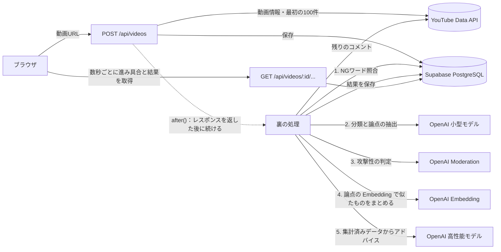

# CommentGuard JP

YouTube のコメントを AI で分析し、発信者が**心をすり減らさずに**コメントを読めるようにする、日本語特化の Web アプリです。

- 公開 URL：（デプロイ後に追記）
- 要件定義書：[docs/requirements.md](docs/requirements.md)／テーブル定義書：[docs/table-definition.md](docs/table-definition.md)
- 分類の評価結果：[docs/evaluation.md](docs/evaluation.md)



## 何を解決するアプリか

コメント欄には、動画を良くするヒントになる質問や要望と、読むだけで傷つく攻撃的な言葉が混ざっています。
発信者は、ヒントを拾うために、攻撃的な言葉まで読まされてしまいます。

CommentGuard JP は、動画の URL を入れるだけで、次のことをします。

1. **コメントを7種類に分ける**：ポジティブ、質問、指摘・要望、否定的意見、スパム、要注意（攻撃的）、その他。
   攻撃的なコメントは「要注意」のタブに分けるので、意図して見に行かない限り目に入りません。
2. **似た質問・要望をまとめて、ランキングにする**：「BGMが大きい　20件」「使っている鍋　8件」のように、多かった声が一目で分かります。
   言い方がきついコメントでも、中身の質問や要望はランキングに数えます（役に立つ指摘を見落とさないため）。
3. **AI が次の動画へのアドバイスを書く**：「こういう要望が多いので、こうしてみては」と、根拠と提案をセットで、やさしい言葉で伝えます。
   暴言やスパムは AI に渡さないので、アドバイスに混ざりません。

ログインなしでも1本試せます（ゲストは24時間で自動削除）。無料登録すると、複数の動画を最長29日間保存できます。

## 主な機能

| 機能 | 内容 |
| --- | --- |
| コメントの取得 | YouTube Data API で最新100スレッドをすぐ取得し、残り（最大1000スレッド）は裏で取得 |
| 分類 | NGワード辞書 → AI（小型モデル、50件ずつまとめて送る）→ OpenAI Moderation API の3段階で判定 |
| 閲覧 | 分類ごとのタブ、スレッド表示（返信は折り畳み）、検索、並べ替え、無限スクロール。「すべて」タブは警告を出してから表示 |
| ランキング | 指摘・要望と質問、それぞれ上位3件。項目を選ぶと、そのグループのコメントだけを表示 |
| AIアドバイス | 分類・集計済みのデータだけを高性能モデルに渡して、1動画につき1回生成 |
| 利用モード | ゲスト（Cookie で識別、同時に1本）とログインユーザー（Supabase Auth） |
| データの削除 | YouTube の規約に合わせて自動削除（ゲスト24時間、ログイン29日）。ログインユーザーは手動でも削除できる |

## 技術スタック

| レイヤー | 技術 |
| --- | --- |
| フレームワーク | Next.js 16（App Router、Route Handlers、`after()`）、TypeScript |
| UI | React 19、Tailwind CSS、shadcn/ui |
| DB・認証 | Supabase（PostgreSQL、pgvector、Row Level Security、Auth） |
| AI | Vercel AI SDK、OpenAI（分類・アドバイス・Moderation・Embedding） |
| 外部 API | YouTube Data API v3 |
| テスト | Vitest（DB は本物のローカル Supabase、AI と YouTube は偽物に差し替え） |
| ホスティング | Vercel（予定） |

## 全体の流れ



画面は、分析が済んだコメントから順に表示します（分析前のコメントを見せると、攻撃的な言葉が分類される前に目に入ってしまうため）。

## 設計で工夫したこと

### 1. 「見逃すより、誤って要注意にするほうがよい」という判定方針

利用者は、コメントで心を痛めやすい発信者を想定しています。そこで「要注意」の基準を厳しくし、
誹謗中傷だけでなく、見下す言い方、嫌味、上から目線の説教なども要注意にしています。
判定は3段階で、どれか1つでも攻撃的と判断すれば要注意になります。

- 文脈に関係なく悪意としか読めない語（「死ね」など）は、NGワード辞書だけで即決（AI に送らない）
- それ以外は AI が文脈で判断（「殺す」はゲームの話でも使うので、辞書ではヒントとして渡すだけ）
- 最後に OpenAI Moderation API で二重に確認

### 2. ゲストとログインユーザーを、同じ表で安全に扱う

所有者の列（`user_id` と `guest_id`）を持つのは `videos` 表だけにし、コメントや分析結果は動画をたどって所有者を確かめます。
ゲストがログインしたときのデータの引き継ぎは、`videos` の1行を書き換えるだけで済みます。

- ログインユーザーのデータは、PostgreSQL の Row Level Security で守る
- ゲストのデータは、ブラウザから DB に直接触らせず、API Route（`src/server/access.ts`）だけで所有を確かめる
- 他人の動画、期限切れの動画、存在しない動画は、すべて同じ「404」にする（他人の動画があるかどうかを推測させないため）
- 「ゲストAがゲストBのデータを読めない」ことを、自動テストで確かめている

### 3. YouTube の規約に合わせたデータの自動削除

YouTube API Services の規約では、取得したデータを30日以内に削除する必要があります。
ゲストは24時間、ログインユーザーは29日（削除の遅れに備えて1日の余裕）で、1時間ごとのジョブが削除します。
ジョブが遅れても期限切れのデータが見えないよう、読み取りのたびにも期限を判定しています。
サムネイル画像は保存せず、YouTube の URL を参照しています。

### 4. 似た質問・要望のまとめ方（試行錯誤）

最初はコメント本文どうしの Embedding を比べていましたが、料理動画では「親子丼」のような主題がどのコメントにも出てくるため、
「パセリの代用」「使っている鍋」「値段」など別々の質問が1つのグループになってしまいました。
そこで、分類の AI に「論点」（例：「イタリアンパセリの代用」）も一緒に出させ、論点どうしを比べる方式に変えました。
AI を呼ぶ回数は増えず、論点はそのままランキングの見出しにも使えます。

### 5. AI の費用を抑える

- コメントは50件ずつまとめて安い小型モデルに送り、高性能モデルには集計済みの短いデータだけを渡す
- 本文のハッシュを保存し、変わっていないコメントは分析し直さない
- 1日に登録できる動画の数に上限（ゲストは同じ IP から5本、ログインユーザーは1人10本、アプリ全体で50本）
- AI の呼び出しごとに、トークン数と推定費用を `api_usage_logs` に記録

## 分類の評価結果

架空のコメント100件に人が正解を付け、本番と同じ判定で分類した結果です（詳しくは [docs/evaluation.md](docs/evaluation.md)、方法は下の「分類の評価」）。

| 指標 | 結果 |
| --- | --- |
| 正解率（7種類の分類） | **99%**（99／100件） |
| 要注意の見逃し | **0%**（20件中0件） |
| 誤って要注意にした割合 | 0%（80件中0件） |
| 100件の分類にかかった費用 | 約0.0025ドル（約0.4円） |

> 注意：評価用のコメントは、作り手（指示文の内容を知っている側）が用意したものです。
> そのため、実際の YouTube のコメント（くだけた言い回し、絵文字、文脈に頼った皮肉など）では、正解率はこれより下がる見込みです。
> 実際のコメントは規約上リポジトリに保存できないため、架空のコメントで評価しています。

## 品質の確かめ方

3つの方法を組み合わせています。

| 方法 | 何を確かめるか | 実行 |
| --- | --- | --- |
| 自動テスト（Vitest、19ファイル） | 毎回同じ結果になるべきロジック。DB はローカルの本物の Supabase を使い、外部の AI と YouTube だけを偽物に差し替える | `npm test` |
| 分類の評価 | 毎回結果が少し変わる AI の分類の正しさを、正解付きのデータで数字にする | `npm run eval` |
| 手動の動作確認 | 画面の操作、見た目、本物の YouTube と AI を通した一連の流れ。機能ごと（スライス）に手順書を書いて確認した | [docs/local-check/](docs/local-check/) |

自動テストで確かめている主な内容：

- **アクセス制御**：ゲストAがゲストBの動画・コメント・分析結果を読めない、公開用の鍵で DB を直接読んでもゲストのデータは見えない、ログインユーザーは RLS で他人のデータを読めない、他人の動画と期限切れの動画は同じ404になる
- **データの保持**：期限切れのデータは読み取り時にも見えない、削除ジョブが期限切れの動画と子データを消す、ゲストからログインへの引継ぎで期限切れの動画は引継がない
- **利用上限**：ゲストは同時に1本、1日の登録回数（ゲストのIP単位、ユーザー単位、アプリ全体）
- **分析**：NGワードの検出、分類の組み合わせ（NGワード・AI・Moderation）、AI が失敗したときの扱いとやり直し
- **グルーピングとランキング**：似た論点の合流、件数の数え直し、順位の決め方
- **その他**：YouTube の URL の判定、API の応答の変換、コメントの並び順・検索、AIアドバイスの生成条件

## 開発の進め方

- 最初に要件定義書とテーブル定義書を書き、決まっていないことは【未決定】として残し、決めたら理由と一緒に【確定】に書き換えた
- 機能ごと（スライス）に実装し、1スライスごとにコードを読んで、GitHub の Pull Request で直した
- 作らないと決めたもの：Docker、CI、課金。スマートフォン対応（PC ブラウザ専用、画面幅1280px以上）

---

## 開発者向けの情報

### コードの読み方：`[Supabase固有]` の印

このプロジェクトは、一般的なWeb開発の学習を目的にしている。
一般的な知識（Next.js、HTTP、Cookie、SQL、PostgreSQL など）と、Supabase 固有の知識を区別できるよう、
**Supabase 固有の仕組みに依存するコードには、コメントに `[Supabase固有]` と書いている。**

```
grep -rn "Supabase固有" src supabase tests
```

`[Supabase固有]` の主な例：

| 仕組み | 一般的な技術で言い換えると |
| --- | --- |
| anon キー / service role キー | 「権限の弱い公開用の鍵」と「全権限の管理用の鍵」 |
| RLS の `auth.uid()`、`to authenticated` | PostgreSQL の RLS（これ自体は標準機能）に、ログイン中のユーザーIDを渡す Supabase の仕組み |
| `auth.users` テーブル | Supabase Auth が管理するユーザー表。アプリのプロフィール表（`public.users`）とは別 |
| `@supabase/ssr` | ログイン情報（JWT）を Cookie に保存・更新するライブラリ |
| `supabase` CLI（`supabase start` など） | ローカルで DB と認証サーバーを起動する開発ツール |

印のない部分（例：`CHECK` 制約、部分ユニークインデックス、`ON DELETE CASCADE`、トリガー、httpOnly Cookie、
Server Actions）は、Supabase 以外の PostgreSQL や Next.js でもそのまま通用する。

### ローカルでの起動

前提：Node.js 22、Docker（Supabase CLI が内部で使う）

```bash
npm install

# ローカルの Supabase（Postgres・認証サーバー）を起動する。初回はイメージの取得に時間がかかる。
# 起動時に supabase/migrations/ と supabase/seed.sql が適用される。
npm run db:start

# 表示された URL とキーを .env.local に書く（.env.example をコピーして埋める）
npx supabase status
cp .env.example .env.local

npm run dev   # http://localhost:3000
```

### YouTube APIキーの取得

コメントの取得には、YouTube Data API v3 の APIキーが必要（`.env.local` の `YOUTUBE_API_KEY`）。

1. [Google Cloud Console](https://console.cloud.google.com/) でプロジェクトを作る
2. 「APIとサービス」→「ライブラリ」で **YouTube Data API v3** を有効にする
3. 「APIとサービス」→「認証情報」→「認証情報を作成」→「APIキー」でキーを発行する
4. 発行したキーの「APIの制限」で、YouTube Data API v3 だけに制限しておく（キーが漏れたときの被害を減らすため）
5. 「アプリケーションの制限」は「なし」にする。「ウェブサイト（HTTPリファラー）」にすると、サーバーからの呼び出しが
   `API_KEY_HTTP_REFERRER_BLOCKED` で拒否される（リファラーはブラウザが付けるもので、サーバーからの呼び出しには付かないため）

無料のクォータは1日10,000ユニット。動画1本の登録で、ゲストは2ユニット、ログインユーザーは最大11ユニットを使う
（動画情報1回＋コメント1ページにつき1回）。使用量は `api_usage_logs` テーブルで確認できる。

`IP_HASH_SECRET` には、`openssl rand -hex 32` などで作ったランダムな文字列を入れる。

### OpenAI APIキーの取得

コメントの分類（AI）と NG判定（Moderation API）には、OpenAI の APIキーが必要（`.env.local` の `OPENAI_API_KEY`）。

1. [OpenAI Platform](https://platform.openai.com/) にログインし、「Billing」で支払い方法を登録する（分類のモデルは有料。Moderation API は無料）
2. 「API keys」→「Create new secret key」でキーを発行する
3. 「Limits」で、月の利用額の上限を低め（例：5ドル）に設定しておく（キーが漏れたときや、使いすぎたときの被害を減らすため）

分類に使うモデルは `src/lib/config/analysis.ts` の `DEFAULT_CLASSIFY_MODEL`。`.env.local` の `OPENAI_CLASSIFY_MODEL` で上書きできる。
AIアドバイスに使うモデルは同じファイルの `DEFAULT_ADVICE_MODEL`（`gpt-6.1-sol`）。`.env.local` の `OPENAI_ADVICE_MODEL` で上書きできる。
1回の呼び出しごとのトークン数と推定費用は、`api_usage_logs` テーブル（`service = 'openai'`）で確認できる。

### テスト

ローカルの Supabase が起動している状態で実行する（CI は使わない）。
AI と YouTube は偽物（`tests/helpers/fake-ai.ts`、`fake-youtube.ts`）を使うので、テストに APIキーは要らない。

```bash
npm test
```

動画の登録には1日の上限がある（ゲストは同じIPから5本、ログインユーザーは1人10本、アプリ全体で50本。`src/lib/config/limits.ts`）。
テストは自分で作った記録を後片付けするが、手元の画面で1日に50本近く登録した後は、アプリ全体の上限で登録のテストが失敗することがある。
そのときは `npm run db:reset` で DB を作り直す。

DB を作り直したいとき（マイグレーションを追加したときなど）：

```bash
npm run db:reset   # マイグレーションと seed を最初から適用し直す（データは消える）
npm run db:types   # DB の型定義 src/lib/database.types.ts を再生成する
```

### 分類の評価

コメントの分類（AI）がどれだけ正しいかを、数字で確かめる（結果は [docs/evaluation.md](docs/evaluation.md)）。

- 架空のコメント100件（`eval/classification-dataset.json`）に、人が正解の分類を付けておき、本番と同じ方法（NGワード → 分類の AI → Moderation API）で分類して比べる。
  実際の YouTube のコメントは、規約上リポジトリに保存できないため、架空のコメントにしている。
- 正解率に加えて、**要注意の見逃し**（要注意のコメントを、他の分類にしてしまった割合）を重く見る。
  このアプリは、コメントで心を痛めやすい発信者を守るためのもので、「見逃すより、誤って要注意にするほうがよい」という方針のため（要件定義書9.1）。
- 本物の OpenAI を呼ぶので、`.env.local` の `OPENAI_API_KEY` と、ローカルの Supabase（NGワードを読む）が要る。費用は1回あたり数円の見込み。
- AI の結果は毎回少し変わるので、`npm test` には入れていない。

```bash
npm run eval   # docs/evaluation.md を書き出す
```

### ディレクトリ構成

```
src/
  app/                 画面と API Route（Next.js App Router）
  lib/                 ブラウザとサーバーの両方で使えるもの（保持期間の定数、DB の型など）
  server/              サーバー専用（先頭で import "server-only"。ブラウザから import するとビルドエラー）
    access.ts          ★ 所有確認と期限判定の共通関数。API Route は必ずここを通す
    videos/register.ts 動画の登録とコメントの取得（最初の100件＋残り）
    youtube/client.ts  YouTube Data API の呼び出し
    analysis/          コメントの分析（analyze.ts が流れの本体）
                         rules.ts：NGワード、ai.ts：AI の指示文、group-comments.ts：グルーピング、advice.ts：AIアドバイス
    usage.ts           API使用量の記録（api_usage_logs）
  proxy.ts             Next.js 16 の proxy（旧 middleware）。Supabase のトークン更新のみ
eval/                  分類の評価（npm run eval）
supabase/
  migrations/          DB のマイグレーション
  seed.sql             初期データ
tests/                 Vitest
```
