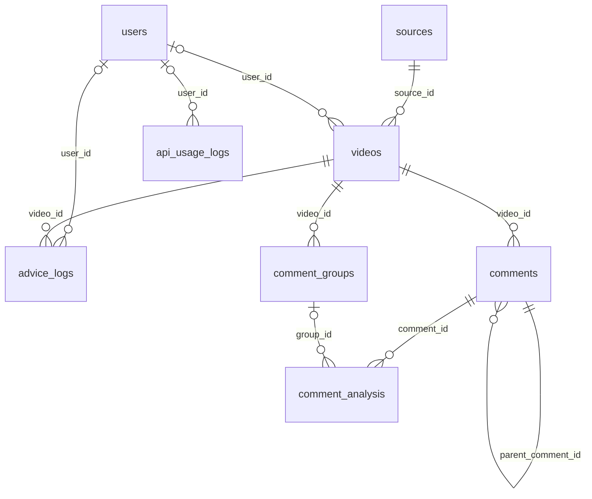

# CommentGuard JP 要件定義（requirements.md）

YouTubeコメントをAIで分析し、発信者がコメントを安全かつ効率的に閲覧できるよう支援する、日本語特化型のコメント分析Webアプリ。

> このファイルは「CommentGuard_JP_要件定義書_v3」を Claude Code 向けに再構成したものです。
> カラム定義は別ファイルの **テーブル定義書**（`docs/table-definition.md`）を正とします（このファイルには載せていません）。

---

## 0. 実装ルール（最初に必ず読むこと）

### 0.1 表記

- **【確定】**：決定済み。そのとおりに実装する。
- **【未決定】**：まだ決まっていない。第20章に一覧がある。

### 0.2 未決定事項の扱い

- 【未決定】の事項を、独自の判断で確定させない。
- 実装上どうしても必要な場合は、次のどちらかにする。
  1. ユーザーに確認する。
  2. 値や挙動を定数・設定として切り出して仮置きし、コード上に `TODO(未決定)` を付け、作業の最後に一覧で報告する。
- 本書とテーブル定義書が食い違う場合は、勝手に直さずユーザーに確認する。

### 0.3 開発の進め方

- 機能単位（スライス）で実装し、スライスごとにコミットを分ける。巨大な1コミットにしない。
- 実装順の目安は次のとおり。
  1. 土台、DB、データ所有（ゲストとログイン）、アクセス制御
  2. コメント取得、API使用量の記録、ゲスト上限
  3. コメント分類
  4. グルーピングとランキング
  5. AIアドバイス
  6. 評価、README、デプロイ（別途指示する）
- 各スライスの完了後、ユーザーがコードを読む。修正はGitHubのPRで行う。
- テストは次の2つを最低限書く（CIは使わず、ローカルで実行する）。
  - ゲストAがゲストBのデータを読めないこと（アクセス制御）
  - グルーピングロジック
- 作らないもの：Docker、GitHub ActionsによるCI、課金・料金プラン。

### 0.4 決定事項の反映ルール

【未決定】だった事項を決めたら、その決定を入れる変更と**同じPR（コミット）**で、次を更新する。

1. 本書：該当箇所の【未決定】を【確定】に書き換え、理由を1〜2行添える。第20章の該当項目も削除する。
2. テーブル定義書（`docs/table-definition.md`）：テーブル、カラム、制約、インデックスに影響する場合。
3. DBマイグレーション（`supabase/migrations/`）：スキーマ変更がある場合。

- 実装中に新しく判断が必要になり、ユーザーと決めたことも、同じ形式（【確定】＋理由）で本書に追記する。
- 実装が本書の内容と食い違う場合は、黙って実装を優先しない。本書を更新するか、ユーザーに確認する。

---

## 1. 概要

### 1.1 名称

CommentGuard JP（コメントガードJP）

### 1.2 コンセプト

- YouTubeコメントをAIで分析し、発信者が安全かつ効率的にコメントを閲覧できるよう支援する。
- MVPではYouTubeのみを対象とする。

### 1.3 解決する課題

- 大量のコメントを手作業で確認する負担
- 誹謗中傷、煽り、攻撃的コメントによる心理的負担
- 動画改善につながる有益なコメントの見落とし
- コメントから視聴者の要望や改善点を整理する負担

### 1.4 主な機能の価値

- 攻撃的・有害なコメントを識別し、閲覧負担を軽減する
- 建設的な指摘や要望を抽出する
- 類似した指摘をまとめ、ランキング表示する
- コメント分析結果をもとに、AIが動画改善のアドバイスを生成する

### 1.5 対応環境

- MVPはPCブラウザ専用のWebアプリ（画面幅1280px以上、推奨1440×900以上）
- 対応ブラウザは Chrome、Edge、Safari の主要最新版
- 1280px未満の場合は、対象外である旨を表示する
- UIは ChatGPT や Gemini のようなシンプルな操作感を目指す
- 本格的なレスポンシブ対応、iOS、Androidは対象外

---

## 2. MVPの範囲

### 2.1 対象媒体

- YouTubeのみ。
- `sources` テーブルは将来の媒体追加のために保持するが、MVPの実装対象はYouTubeのみ（`name='youtube'` 固定）。

### 2.2 MVP対象機能

1. YouTube動画URL入力
2. YouTube動画情報取得
3. YouTubeコメント取得
4. コメント保存
5. コメントのAI・ルール分析
6. コメント分類・NG判定
7. 建設的な指摘の抽出
8. 類似した指摘の集約
9. 指摘ランキング表示（質問ランキングを含む）
10. AIアドバイス生成
11. 動画・コメント・分析結果の一時保存（ゲストは24時間、ログインユーザーは最長29日で自動削除）
12. ログイン不要モード（ゲスト）
13. ログインモード
14. ログインユーザーによる動画の削除
15. 利用規約・プライバシーポリシーのページ

### 2.3 MVP対象外

- TikTok、Instagram、X
- iOS、Android
- 本格的なレスポンシブ対応
- YouTubeへの自動コメント削除、YouTube側への自動モデレーション操作
- 全返信コメントの完全取得
- 動画そのものを対象としたAI分析
- AIアドバイスの再生成（ユーザー操作による）
  - `advice_logs.triggered_by` などの列は、将来のために保持する。

---

## 3. 利用モード

### 3.1 ログイン不要モード（ゲスト）【確定】

サービスを試用するためのモード。

- ログインなしで利用できる。
- `users` とは紐づけない。
- 保存方式：サーバー保存（`videos.guest_id` 方式）
- セッション識別：httpOnly Cookie に `guest_id`（uuid）を発行して保持する。
  - Cookie有効期限は24時間（DBのゲストデータ保持期間と同一）。
  - 有効期限の起点【確定】：ゲストが動画を作成した時点で Cookie を（再）発行し、その時点から24時間とする。
    - 理由：初回訪問時に発行すると、訪問から時間が経ってから動画を作った場合に、データより先に Cookie が切れてしまうため。起点を `videos.created_at` とほぼ同じにする。
- データ保持期間：24時間（3.3参照）
- 利用上限：同時に保持できる動画は1本のみ。
  - 既に1本保持した状態で「＋新しい動画」を押した場合、URL入力の代わりにアカウント登録導線（4.3の③）を表示する。
- ログイン後のデータ引継ぎ：確認画面なしで自動的に行う。
  - サインアップ／ログインが成立し、有効な `guest_id` Cookie があれば、次を実行して Cookie を削除する。
  - `UPDATE videos SET user_id = 新user_id, guest_id = NULL WHERE guest_id = Cookieの値 AND created_at >= 現在時刻 - ゲストの保持期間`
  - 期限切れ（作成から24時間超）のゲスト動画は引継がない。理由：削除ジョブの実行前に引継ぐと、ログインユーザーの期間（29日）が適用されて、消えているはずのデータが復活してしまうため（3.3の「期限切れは見つからないものとして扱う」の一部）。
  - 引継ぎ後は、ログインユーザーの保持期間（3.3）が適用される。起点は元の `created_at` のまま変えない。
- 24時間削除の事前案内：URL入力状態の入力欄の下に常時表示する。
  - 文言：「ゲストとして利用中：分析結果は24時間で自動的に削除されます。アカウント登録すると、複数の動画を最長29日間保存できます」
  - 日数は、定数（3.3）から表示する。
- コメント取得上限：100スレッド（7.2参照）
- Cookie を発行するのは、動画の登録が成功したとき（URLの誤りやYouTubeのエラーで失敗したときは発行しない）。
- IP単位の上限【確定】：同じIPアドレスから、直近24時間に動画を登録しようとできる回数を、定数 `GUEST_DAILY_VIDEO_LIMIT` で制限する。
  - 理由：Cookie を削除すれば新しいゲストになれるため、「同時に1本」だけでは何度でも分析できてしまう。
  - 数えるのは、YouTube に動画情報を問い合わせた回数（`api_usage_logs` の `videos.list`。存在しない動画も含む）。Cookie を変えても数える。
  - IPアドレスはそのまま保存せず、秘密の鍵（`IP_HASH_SECRET`）を使った HMAC-SHA256 で変換した値（`ip_hash`）だけを保存する。
  - 上限の値は【確定】：5本。
    - 理由：試しに使うには十分で、それ以上使う人にはアカウント登録を案内したいため。変える場合は定数だけを直せばよい。
  - 上限に達したときは、アカウント登録を案内するメッセージを返す（15.1の `guest_daily_limit`）。

### 3.2 ログインモード

長期利用ユーザー向けのモード。

- Supabase Auth を利用する。
- `users` でユーザー情報を管理する。
- ユーザーに紐づけて、動画、コメント、分析結果、アドバイス等を保存する。保存期間は最長29日で、その後は自動的に削除される（3.3参照）。
- ゲストとの違いは、保存期間が長いこと、同時に保持できる動画が複数であること、コメント取得上限が大きいこと。
- 保存期間の案内：URL入力状態の入力欄の下に、「分析結果は最長29日間保存され、その後自動的に削除されます」と表示する。日数は、定数（3.3）から表示する。
- ログインユーザーは、自分の動画を削除できる（18.2参照）。
- コメント取得上限：1000スレッド（7.2参照）
- 認証方式は【確定】：メールアドレスとパスワード（Supabase Auth）。メール確認は行わない（サインアップ後すぐにログインできる）。
  - 理由：MVPではシンプルな導線を優先するため。ローカルは `supabase/config.toml` の `enable_confirmations = false`。
  - 本番の Supabase プロジェクトでも、Authentication の Email プロバイダーで「Confirm email」を無効にすること（デプロイのスライスで設定）。
- プロフィール項目、権限体系の詳細は【未決定】。

### 3.3 データ保持期間【確定】

YouTubeのAPIから取得したデータは、YouTube API Services の規約により、取得から30日以内に削除または更新する必要がある（OAuthの有無にかかわらず同じ）。この規約を守るため、保持期間を次のとおりとする。

| 利用モード | 保持期間 | 定数 |
| --- | --- | --- |
| ゲスト | 24時間 | `GUEST_RETENTION_HOURS`（初期値24） |
| ログインユーザー | 29日 | `USER_RETENTION_DAYS`（初期値29） |

- ログインユーザーを規約の上限の30日ではなく29日にするのは、削除ジョブの実行間隔や遅延によって、30日を超えて保持してしまうことを避けるため。
- 保持期間はコードに直接書かず、上の定数で管理する。規約の確認結果などで変更する場合に、定数だけで済むようにする。
- 対象：`videos` と、その子データ（`comments`、`comment_analysis`、`comment_groups`、`advice_logs`）すべて。分析結果やアドバイスもコメントから作られたデータなので、同じ期限で削除する。
- 起点：`videos.created_at`。コメントの再取得や再分析では延長しない。
- 適用する期間：`guest_id IS NOT NULL` の動画にはゲストの期間、`user_id IS NOT NULL` の動画にはログインユーザーの期間を適用する。
- ゲストからログインへの引継ぎ時：`created_at` は変えず、引継ぎ後はログインユーザーの期間が適用される。
- 削除方法：1時間ごとに実行する定期ジョブが、期限を超えた `videos` 行を削除する。子データは `ON DELETE CASCADE` で連鎖して削除される（13.4）。
- スケジュール方式【確定】：Supabase の `pg_cron` と `pg_net` で、1時間ごとに API Route（`/api/cron/purge-expired`、`CRON_SECRET` で保護）を呼び出す。削除の本体は TypeScript（`src/server/purge-expired.ts`）に置く。
  - 理由：保持期間の定数を TypeScript の1か所で管理でき、テストもしやすいため。Vercel Cron は Hobby プランでは1日1回までのため採用しない。アプリが停止していてジョブが失敗しても、読み取り時の期限判定により期限切れのデータは見えない。
  - `pg_cron` の登録は、デプロイ先のURLが決まるデプロイのスライスで行う。
- 削除の遅れへの備え：ジョブの実行前でも期限切れのデータが見えないよう、API Route でのデータ取得時にも、期限内かを判定する。期限を超えていれば「見つからない」として扱う。
- 対象外：`users` と Supabase Auth のアカウント情報、`api_usage_logs`（YouTubeのデータではないため。`api_usage_logs` の保持期間は【未決定】、17.2）。
- 削除後に動画が見つからない場合、エラー表示はせず「①URL入力状態」として扱う。

---

## 4. 画面構成

### 4.1 基本方針【確定】

ChatGPT、Gemini のように、基本的に1画面で完結する3ペインレイアウトとする。

| 左ペイン | 中央ペイン | 右ペイン |
| --- | --- | --- |
| 動画一覧、＋新しい動画 | ①URL入力欄、②分析結果表示（コメント一覧）、③登録導線 のいずれかを表示 | インサイト（指摘・要望ランキング、質問ランキング、AIアドバイス） |

- 画面のURL【確定】：トップ（`/`）は①または③、動画ごとのページ（`/videos/:id`、`:id` は `videos.id`）は②を表示する。左右の枠は共通。
  - 理由：再読み込みやブラウザの「戻る」で、同じ動画に戻れるようにするため。

### 4.2 左ペイン

- 「＋新しい動画」：クリックすると、中央ペインが①URL入力状態に切り替わる（モーダルは使わない）。
  - ゲストが既に動画を1本保持している場合は、③登録導線状態を表示する。
- 「動画一覧」：1動画につき、サムネイルとタイトルを表示する。
  - ゲストの場合、リストは常に0〜1件。
  - 保持期間（3.3）を過ぎた動画は自動で削除されるため、一覧には期限内の動画だけが表示される。
  - ログインユーザーは、各動画を削除できる（18.2参照）。

### 4.3 中央ペイン（3状態）

#### ① URL入力状態

- 初回訪問時、または「＋新しい動画」クリック時に表示する。
- YouTube動画URLの入力欄を表示する。
- 入力欄の下に、保存期間の案内を常時表示する（ゲストは3.1、ログインユーザーは3.2の文言）。
- URL送信後、②分析結果表示状態に遷移する。

#### ② 分析結果表示状態

- タブは `primary_category` に1対1で対応する6タブと「すべて」の計7タブ。順番も確定。
  1. ポジティブ（`praise`）
  2. 質問（`question`）
  3. 指摘・要望（`feedback`）
  4. 否定的意見（`negative_opinion`）
  5. スパム（`spam`）
  6. 要注意・攻撃的（`harmful`）
  7. すべて（フィルタなし、全件表示）
- `other` は専用タブを持たず、「すべて」タブ内でのみ表示する。
- スライス3（コメント分類）までは、タブを置かずにコメント一覧だけを表示する【確定】。理由：分類の結果がないと、タブの中身を作れないため。
- 親コメントと返信をスレッド形式で表示する。返信はデフォルトで折り畳む。
- コメント本文用の検索バーを置く。
  - 検索するのは、親コメントの本文（部分一致）。返信は検索の対象に含めない【確定】。
    - 理由：返信は最初は折り畳まれているので、見えない返信が一致すると、なぜその親コメントが出たのかわかりにくいため。
- 並び順【確定】：「新しい順」「いいねが多い順」「返信が多い順」を切り替えられる。一覧を開いたときは「新しい順」。
  - 「返信が多い順」は、1階層目の返信の総数（YouTube の値。7.3）で並べる。
  - 理由：発信者が、反応の多いコメントや話題になっているコメントから読めるようにするため。
  - 並べ替えと検索は、親コメント（スレッド）の単位で行う。返信は、その親コメントの下に表示する。
- コメントを取得中（`fetch_status = 'fetching'`）の間は、画面が数秒ごとに取得の状況を確かめ、取得が終わったら一覧を自動で読み込み直す【確定】。
  - 理由：ユーザーが再読み込みの操作をしなくても、残りのコメントが表示されるようにするため。
- 「デフォルト非表示」のロジック（`is_hidden_by_default`、`visibility_reason` など）は持たない。
  - 代わりに、「すべて」タブを選択したときだけ警告ダイアログを表示する。
  - 文言：「誹謗中傷・スパムを含むコメントも表示されます。よろしいですか？」
  - 「要注意・攻撃的」タブは意図して見に行く場所なので、警告は出さない。
- 「否定的意見」「スパム」「要注意・攻撃的」「すべて」のタブは、誤って選択される可能性を考慮し、半透明で表示する。

#### ③ 登録導線状態

ゲストが動画を1本保持した状態で「＋新しい動画」を押したときに表示する。

- アイコンと見出し「ゲストは同時に1本までです」
- 本文：複数の動画を保存・分析するには無料アカウント登録が必要である旨
- 主要CTA：「無料で登録する」（塗りボタン）
- 副次リンク：「ログインする」
- 戻る導線：「今の動画に戻る」（②分析結果表示状態へ遷移）

### 4.4 右ペイン

- ランキング（スライス4）とAIアドバイス（スライス5）ができるまでは、それぞれ「準備中」と書いた枠を置く【確定】。

- **指摘・要望ランキング**：同じ意味を持つ指摘・要望をまとめて集計し、多かった順に1〜3位まで表示する。
  - 例：1位「BGMが大きい」20件、2位「映像が暗い」10件、3位「もっと被写体に寄ってほしい」5件
- **質問ランキング**：指摘・要望ランキングと同様に、同じ意味を持つ質問を集計し、1〜3位まで表示する。
- **AIアドバイス**：コメントの意見を総合して、動画の評価された点と改善アイデアを提案する。コメントをもとに、次の動画のアイデアも提案する。

---

## 5. 基本処理フロー

```
YouTube URL入力
  ↓
URL／動画ID検証
  ↓
YouTube APIから動画情報取得
  ↓
videosへ保存
  ↓
YouTube APIからコメント取得
  ↓
commentsへ保存・更新
  ↓
未分析または再分析対象コメントを抽出
  ↓
ng_wordsによるルール判定
  ↓
AIによるコメント分析
  ↓
comment_analysisへ保存
  ↓
建設的な指摘・要望、質問を抽出
  ↓
類似した指摘・質問をグルーピング（comment_groups）
  ↓
指摘・要望ランキング、質問ランキング生成
  ↓
AIアドバイス生成
  ↓
advice_logsへ保存
```

- 残りのコメントの取得方法は【確定】（7.2）。
- コメント分析・アドバイス生成の非同期化方法と、アドバイスの生成条件は【未決定】。

---

## 6. 動画情報取得

- ユーザーがYouTube動画URLを入力し、URLから動画IDを抽出する。
- 受け付けるURLの形式【確定】（`src/lib/youtube-url.ts`）
  - `https://www.youtube.com/watch?v=動画ID`（`youtube.com`、`m.youtube.com` も可）
  - `https://youtu.be/動画ID`
  - `https://www.youtube.com/shorts/動画ID`
  - `https://www.youtube.com/live/動画ID`
  - 動画IDは英数字・`-`・`_` の11文字。
- 許可されていない形式のURL（チャンネル、再生リスト、埋め込み、他サイトなど）はエラーとする。
- 動画情報と、コメントの最初のページを取得できてから `videos` に保存する【確定】。
  - 理由：「動画が見つからない」「コメントが無効」などのエラーのときに、中身のない動画を残さないため（ゲストの1本の枠も消費しない）。
- YouTube Data API を利用する。
- `videos` テーブルに保存する項目：媒体種別、媒体側動画ID、動画タイトル、サムネイルURL、公開日時、作成日時
- コメント取得の状況を表す `fetch_status`（`fetching` 取得中／`done` 完了／`failed` 失敗）を持つ【確定】。
  - 理由：残りのコメントをバックグラウンドで取得する間（7.2）、画面に「取得中」「失敗」を表示するため。
- その他の追加項目は【未決定】。
- 同じユーザーが同じ動画を複数回登録してもよい。重複登録を禁止するユニーク制約は設けない【確定】。ただしゲストは3.1の「同時に1動画」の制限を受ける。
- サムネイルは、URLのみを保存する。画像ファイルはダウンロード・保存しない【確定】（YouTubeの規約で、画像の保存が禁止されているため）。表示は、URLを参照して行う。
  - 画面では `` で YouTube のURLをそのまま表示する。Next.js の `<Image>` は、画像を自分のサーバーで縮小・保存（キャッシュ）するため使わない【確定】。

---

## 7. コメント取得

### 7.1 取得単位

1回のYouTube APIリクエストで最大100スレッドを取得する。`nextPageToken` を利用する。

### 7.2 取得上限

- ゲスト：100スレッド（定数 `GUEST_MAX_THREADS`）
- ログインユーザー：1000スレッド（定数 `USER_MAX_THREADS`）
- 初期表示では最新100スレッドを取得し、残りをバックグラウンドで取得する。
- 残りの取得方法【確定】：Next.js の `after()` で、レスポンスを返した後に、同じサーバー処理の続きとして残りのページを順に取得する。
  - 理由：残りは最大900スレッド（YouTube APIの呼び出し最大9回）で短時間に終わる見込みで、外部のジョブ管理サービスが不要なため。画面側から繰り返し呼び出す方式は、タブを閉じると止まるため採用しない。
  - 取得中は `videos.fetch_status = 'fetching'`、終わったら `done`、途中で失敗したら `failed` にする。失敗しても、取得済みのコメントは残す。
  - ゲストは上限が100スレッド（1ページ）なので、バックグラウンドの取得はない。

### 7.3 親コメントと返信

- 親コメントは原則すべて取得する。
- 返信は `commentThreads.list` に同梱される範囲のみ取得する。返信専用のページネーション（全件取得）は将来機能。
- 返信の総数は、YouTube が返す値（`totalReplyCount`）を、親コメントの `comments.reply_count` に保存する【確定】。
  - 理由：同梱される返信は数件だけなので、保存した返信を数えても「返信が多い順」（4.3）が正しくならないため。値は取得の応答にもともと入っており、YouTube への問い合わせは増えない。

### 7.4 重複防止と再分析

- 同じYouTubeコメントIDを持つコメントは重複登録しない。DBの制約でも保証する（`comments` の `(video_id, external_comment_id)` にユニーク制約。テーブル定義書6.1参照）。
- 再取得時の扱いは次のとおり。
  - 新規コメント：分析対象
  - 既存コメントの内容変更：再分析対象
  - 変更のない既存コメント：原則として再分析しない
- 本文ハッシュ：`SHA-256(comment_text)` を `comments.body_hash` に保存する。
  - 対象は `comment_text` のみ。メタデータの変化は再分析のトリガーにしない。
  - 本文が変わったコメントだけを UPDATE する（`updated_at` が更新される）。変わっていないコメントは、いいね数が変わっていても更新しない。
- 再取得のタイミング【確定】：MVPでは、コメントを取得するのは動画の登録時の1回だけ。取り直しの操作（ボタンなど）は将来機能。
  - 理由：YouTube APIとAIの費用を抑えるため。上の重複防止と本文変更の検知は、登録時の取得でもページの間で同じコメントが重複することがあるため、MVPから実装する。

---

## 8. コメント分類・分析

### 8.1 基本方針【確定】

複合的な日本語コメントを表現するため、`primary_category`（単一）と `labels`（複数）のハイブリッド方式にする。

- **primary_category**：UIのタブ振り分けと件数集計に使う主分類（1コメント1つ）
- **labels**：分析・抽出・検索に使う属性タグ（1コメントにつき複数可）
- `score` は `primary_category` の判定確信度のみを表す。labelsごとの確信度は持たない。

### 8.2 primary_category（7種）

| 値 | 意味 |
| --- | --- |
| `question` | 質問 |
| `feedback` | 改善につながる指摘・要望 |
| `praise` | 称賛・ポジティブ |
| `negative_opinion` | 否定的意見（攻撃性なし） |
| `harmful` | 攻撃的・誹謗中傷・NG |
| `spam` | スパム・宣伝 |
| `other` | 分類不能・雑談 |

### 8.3 primary_category の判定優先順位

上から順にチェックし、最初に該当したものを `primary_category` にする。

1. `harmful`（NG判定）に該当 → `harmful`（最優先。他の性質があっても上書きする）
2. `spam` に該当 → `spam`
3. 上記以外で、feedback／correction 系の内容を含む → `feedback`
4. 上記以外で、question の要素を含む → `question`
5. 上記以外で、praise の要素が主 → `praise`
6. 上記以外で、negative_opinion の要素が主 → `negative_opinion`
7. どれにも当てはまらない → `other`

### 8.4 labels（11種、複数付与可）

| 値 | 意味 |
| --- | --- |
| `positive` | ポジティブ要素を含む |
| `negative` | ネガティブ要素を含む |
| `question` | 質問要素を含む |
| `constructive_feedback` | 建設的な指摘・改善提案 |
| `request` | 要望 |
| `correction` | 誤り指摘・訂正 |
| `harassment` | 嫌がらせ |
| `insult` | 侮辱 |
| `threat` | 脅迫 |
| `spam` | スパム的要素 |
| `off_topic` | 話題と無関係 |

### 8.5 出力例

```json
{ "primary_category": "feedback", "labels": ["positive", "question", "correction"] }
```

### 8.6 補足

- `self_promotion` は独立ラベルとして持たず、`spam` ラベルに統合する。

---

## 9. 否定的意見とNGコメント

### 9.1 基本方針

「否定的な意見」と「NGコメント」は別のものとして扱う。

- 例：「今回の動画は前回より分かりにくかった」は否定的な意見だが、改善に有用な可能性がある。
- 例：「お前は消えろ」のようなコメントは攻撃的コメントとして扱う。

### 9.2 NG判定【確定】

- NG判定の結果は、8章の分析で決まる `primary_category = 'harmful'` で表す。
- 独立したNG判定ステップや、コメントに対するNGフラグは持たない。

判定の組み合わせ順序は次のとおり。

1. `ng_words`（severity=5）にヒット → 即 `harmful` 確定（LLM判定を経ない）
2. `ng_words`（severity 1〜4）にヒット → 分類LLMへのヒントとして使う。
   - ヒットしただけでは `harmful` にしない。
   - プロンプトに「この単語が検出されています」という一文を差し込む、という意味。
3. 分類LLMが `primary_category`（`harmful` を含む）を決定する。
4. OpenAI Moderation API が `flagged=true` の場合、`harmful` に強制上書きする。

#### severity=5 の選定基準（重要）

- 文脈に関わらず、名指しの悪意としか解釈できない語に限定する。
  - 例：「死ね」「消えろ」などの命令形・直接的な脅迫表現
- 動詞の原形・平叙文で使われる語（例：「殺す」）は severity=5 に含めない。
  - フィクションやゲームなど、悪意のない文脈でも使われるため。
  - severity 1〜4 として、LLMに文脈判断させる。
- severity=5 の語は、冗談や自虐目的で使われた場合でも、文脈を問わず `harmful` として確定してよい。
  - 利用者は冗談であっても暴言を見たくない、という前提のため。

#### review_required を立てる条件

- `primary_category = 'harmful'` かつ `score < 0.7`
- severity 1〜4 の `ng_words` ヒットがあるが、最終的に `harmful` 以外と判定された場合

#### ng_words の管理

- アプリ内に登録・編集UIは持たない。
- 初期データはシードスクリプト（`supabase/seed.sql`）で投入する。
- 運用中の追加・修正は Supabase Studio（Table Editor）で直接行う。
- 要件定義書・テーブル定義書には実データを記載しない。
- 管理機能（有効／無効の切り替えなど）は【未決定】。

### 9.3 NGコメントの表示

- 「要注意・攻撃的」タブで確認できる。
- 「すべて」タブでも、警告ダイアログの上で表示される（他タブと同様、隔離・非表示はしない）。

---

## 10. 建設的な指摘の抽出とグルーピング

コメント分析結果から、動画改善につながる可能性があるコメントを抽出し、類似する論点をグルーピングして提示する。

### 10.1 抽出対象【確定】

- `harmful` と `spam` のコメントは、グループとランキングの対象にしない（`labels` に `request` を含んでいても除外する）。
- 1コメントが所属できるグループは最大1つ。次の順に判定する。
  1. `primary_category = 'question'` → `group_type = 'question'`
  2. 上記以外で、`primary_category = 'feedback'` または `labels` に `'request'` を含む → `group_type = 'feedback_request'`
  3. 上記のどちらにも該当しない → グループなし（`group_id = NULL`。embeddingも生成しない）

### 10.2 グルーピング方式【確定】

OpenAI Embedding と、コサイン類似度による判定。

- Embeddingモデル：OpenAI `text-embedding-3-small`
- 類似度の閾値：0.82

### 10.3 処理フロー

1. LLM分析（`primary_category` 確定）の後、対象条件を判定する。
   - 条件を満たす場合のみ、`text-embedding-3-small` で embedding を生成し、`comment_analysis.embedding` に1回だけ INSERT する。
   - LLM分析とEmbedding生成の並行実行は不採用（可読性を優先）。
2. 同一 `video_id`・同一 `group_type` の既存グループと、コサイン類似度を比較する。
3. 類似度が 0.82 以上なら、既存グループに合流する（`comment_count += 1`）。
4. 類似度が 0.82 未満なら、新規グループを作成する。
   - 軽量LLMで `representative_text`（代表論点）を生成する。
   - `representative_embedding` には、そのコメントのembeddingをそのまま格納する。合流時（手順3）には更新しない【確定】。
   - 例：「音が小さい」「声が聞き取りづらい」「BGMに対してナレーションが小さい」 → 「音声・ナレーションが聞き取りづらい」
5. `comment_analysis.group_id` を確定する。

- 既存グループとの類似判定にLLMは使わない。LLMは `representative_text` の生成にのみ使う。

### 10.4 データ構造

```
comment_groups
  id
  video_id
  group_type                enum('feedback_request', 'question')
  representative_text       LLMが生成する代表論点テキスト
  representative_embedding
  comment_count
  created_at / updated_at

comment_analysis
  group_id                  comment_groups.id への外部キー（nullable）
```

---

## 11. ランキング

ランキングは2種類。共通の `comment_groups`（`group_type` で出し分け）で扱う。

- 指摘・要望ランキング（`feedback_request`）
- 質問ランキング（`question`）

ランキングの母数は `comment_groups.comment_count`。次の要素をもとに順位を決める。

- 類似コメント数
- いいね数
- 新しさ

表示件数は、どちらのランキングも1〜3位まで【確定】。

次の項目は【未決定】。

- 具体的な計算式（いいね数と新しさの重み付け）
- 同率順位の扱い

---

## 12. AIアドバイス

### 12.1 目的

コメント分析と指摘ランキングをもとに、次回動画やチャンネルの改善につながるアドバイスを生成する。

### 12.2 入力

全コメントをそのまま高性能モデルへ渡すのではなく、分析・集計済みの情報を渡す。

```json
{
  "video_title": "動画タイトル",
  "analyzed_comment_count": 1000,
  "category_counts": {
    "question": 120,
    "feedback": 180,
    "praise": 540,
    "harmful": 20,
    "other": 140
  },
  "top_feedback_clusters": [
    {
      "topic": "音声が小さい",
      "comment_count": 42,
      "total_likes": 135
    }
  ]
}
```

- 上記は入力形式の例。`category_counts` には7種のカテゴリすべてを含めること。

### 12.3 生成単位

1動画につき、1アドバイス。

### 12.4 保存

`advice_logs` に生成履歴を保存する。

- `triggered_by`（enum: `system` / `user`）、`user_id`（nullable）、`guest_id`（nullable）を持つ。
- MVPでは再生成機能がないため、`triggered_by = 'system'`、`user_id` / `guest_id` は NULL のみが書き込まれる。

---

## 13. データモデル

### 13.1 テーブル一覧（MVPの正式構成は9テーブル）

| テーブル | 役割 |
| --- | --- |
| `videos` | 動画メタを保持する |
| `comments` | 各動画のコメント本文と投稿メタを保持する |
| `comment_analysis` | AI・ルールによる分析結果を保持する |
| `comment_groups` | 指摘・要望／質問の類似コメントをグルーピングし、ランキングの元データを保持する |
| `ng_words` | NGワード辞書を保持する |
| `advice_logs` | AI生成したアドバイスの履歴を保持する |
| `users` | 認証ユーザーのプロフィール・権限情報を保持する |
| `sources` | 対応媒体の情報を保持する |
| `api_usage_logs` | YouTube・AIのAPI使用量を記録する（スライス2で追加【確定】） |

カラム定義は、すべてテーブル定義書を参照する。

### 13.2 設計判断

#### videos

- `user_id`（nullable）と `guest_id`（nullable）の排他カラムで、ログインユーザーとゲストの両方に対応する。
- 他テーブル（`comments`、`comment_analysis`、`advice_logs`、`comment_groups`）は `user_id` / `guest_id` を持たない。`video_id` 経由で `videos` の所有権を辿る正規化設計とする。
  - 理由：ゲストから会員への移行が `videos` の1行更新だけで完結するため。
- `video_id`（YouTube側の外部動画ID）は、内部の `id` とは別物。コメント取得APIを叩く際のキーとして使う。
- `source_id` → `sources.id` の直接FK参照。
- `created_at` が、期限切れ削除（3.3）の起点になる。削除ジョブの検索用に `created_at` にインデックスを張る。

#### comments

- `parent_comment_id`（自己参照FK）方式を採用する。将来、他媒体に対応する際も、階層構造を自己参照だけで表現できるため。
- `raw_payload`（YouTube APIの生データ）は持たない。型付きカラムで必要な項目を個別に保持する。
- 注意：YouTube APIが返す「親コメントの `external_comment_id`」は、内部の `parent_comment_id`（uuid）とは別物。保存時に `external_comment_id` → `id`（内部uuid）への変換が必要。

#### comment_analysis

- 分類方式：`primary_category`（単一・7種、harmful最優先の判定順）と `labels`（複数付与可・11種）。
- `score`：`primary_category` の判定確信度。
- `primary_category = 'harmful'` を、そのままNG判定に使う。
- NG・スパムコメントの表示／非表示を持つカラムは不要（UIの「すべて」タブ＋警告ダイアログ方式で代替する）。
- 再分析履歴は `is_latest` フラグ方式。
  - 再分析時は既存行を `is_latest = false` に更新し、新しい結果を `is_latest = true` で新規INSERTする（履歴は削除しない）。
  - 現在の分析結果は常に `WHERE comment_id = X AND is_latest = true` で取得する。
- `embedding` は、10.1のグループ対象になるコメント（`harmful` / `spam` を除き、`primary_category` が `question` または `feedback`、もしくは `labels` に `request` を含むもの）の場合のみ生成する。対象外は null のまま保存する。
- NGワードのヒット結果は、`comment_analysis.ng_words`（`text[]`）にヒットした単語を配列でそのまま保存する簡易方式（中間テーブルは作らない）。

#### advice_logs

- 生成単位は1動画につき1アドバイス。
- `created_by` 列は廃止。`triggered_by`（`system` / `user`）、`user_id`（nullable）、`guest_id`（nullable）に置き換える。
- 再生成時は既存行を上書きせず、新しい行を INSERT して履歴を残す。
- 「最新のアドバイス」は `video_id` ＋ `generated_at` の降順で取得する（`is_latest` のような専用フラグは持たない。生成頻度が低いため）。

#### users

- `role`：`'user'` / `'admin'` の2値（MVPではこれで十分）。
- Supabase Auth との同期方式は【確定】：DBトリガー方式。`auth.users` に行が追加されたら、`public.users`（`role='user'`）を自動で作成する（`supabase/migrations/20261013000005_sync_auth_users.sql`）。
  - 理由：サインアップの経路に関わらず必ず作られ、アプリ側で作り忘れることがないため。削除側は `users.id → auth.users.id` の CASCADE で連動する。
- 追加プロフィール項目の要否は【未決定】。

#### comment_groups

- 「指摘・要望ランキング」と「質問ランキング」を共通の仕組みで扱うため、`group_type` で出し分ける。

#### api_usage_logs【確定】

- API使用量（17.2）を、ログ出力ではなく専用テーブルに記録する。理由：利用上限（14.2）やゲストのIP単位の上限（3.1）の判定で、DB上で回数を数える必要があるため。
- 1回のAPI呼び出しにつき1行。失敗した呼び出しもクォータを消費するので記録する。
- YouTubeはクォータ消費量（`units`）、AIはモデル名・入出力トークン数・推定費用を記録する（AIの記録はスライス3以降）。
- `video_id` と `guest_id` は外部キーを持たない。動画が削除されても使用量の記録は残すため。`user_id` はアカウント削除時に `SET NULL`。
- `ip_hash` はゲストの記録にだけ入れる（3.1）。
- ブラウザからは読めない（RLSのポリシーなし。サーバー専用）。

#### インデックス方針

- FK列には基本的にインデックスを張る。
- `comment_analysis` のみ、複合インデックス `(comment_id, is_latest)` を追加する。「現在の分析結果」を取得するクエリが全画面で頻発するため。
- インデックス一覧はテーブル定義書を参照。

### 13.3 ER図



- `guest_id` はFKを持たない（Cookieで発行したUUID）。
- `ng_words` は他テーブルとFKを持たない。
- `api_usage_logs.video_id` と `api_usage_logs.guest_id` はFKを持たない（13.2）。

### 13.4 各FKのON DELETE【確定】

動画やユーザーを削除すると、それに属するデータが連鎖して削除される設計とする（期限切れ削除、ユーザーによる動画の削除、アカウント削除を、親の1行の削除で済ませるため）。

| FK | ON DELETE |
| --- | --- |
| `videos.user_id` → `users.id` | CASCADE |
| `videos.source_id` → `sources.id` | RESTRICT |
| `comments.video_id` → `videos.id` | CASCADE |
| `comments.parent_comment_id` → `comments.id` | CASCADE |
| `comment_analysis.comment_id` → `comments.id` | CASCADE |
| `comment_analysis.group_id` → `comment_groups.id` | SET NULL |
| `comment_groups.video_id` → `videos.id` | CASCADE |
| `advice_logs.video_id` → `videos.id` | CASCADE |
| `advice_logs.user_id` → `users.id` | CASCADE |
| `users.id` → `auth.users.id` | CASCADE |
| `api_usage_logs.user_id` → `users.id` | SET NULL |

- 期限切れ削除ジョブ（3.3）は、期限切れの `videos` 行を削除すれば、`comments`、`comment_analysis`、`comment_groups`、`advice_logs` も連鎖して削除される。

---

## 14. AI利用方針とコスト制御

### 14.1 AI利用方針

- **コメント分類**：複数コメントをまとめて安価なモデルへ送信する方式を候補とする。
  - 1バッチ50〜100コメント程度が目安。
  - 具体的なモデルは【未決定】。候補は Gemini Flash-Lite 系、OpenAI Nano 系。
- **NG判定**：OpenAI Moderation API を一次判定として利用する案がある。
  - 日本語特有の嫌味、婉曲表現、建設的な批判との区別は、別途LLMで判断する案がある。
  - 利用サービスと正式フローは【未決定】。ただし判定の組み合わせ順序は9.2で確定している。
- **AIアドバイス**：分類・集計済みデータのみを高性能モデルへ渡す。具体的なモデルは【未決定】。

### 14.2 コスト制御【基本方針】

- 分析結果をDBへ保存する。
- 同一コメントを不要に再分析しない（本文ハッシュを利用する）。
- 複数コメントをまとめてAIへ送信する。
- 1動画あたりの分析対象件数に上限を設ける（7.2の取得上限）。
- AI APIのタイムアウト時は、最大2回まで再試行する案とする。
- AIモデル名をコードへ固定しない（設定で切り替えられるようにする）。
- AI利用量、トークン数、推定原価を記録する（記録先は `api_usage_logs`【確定】。13.2）。
- 利用上限に到達した場合は、追加分析を停止する。
- 月間利用量の制限、料金プラン、無料枠は【未決定】（課金・料金プランは作らない方針）。

---

## 15. エラー・例外処理

### 15.1 YouTube API

想定するケース：

- 動画が存在しない
- 非公開動画
- コメント無効
- APIクォータ超過
- API障害
- その他APIエラー

既存データがある場合、API障害時でも保存済みデータを表示できるようにする案がある。

エラーコード、HTTPステータス、メッセージ【確定】（`src/server/video-errors.ts`）。API Route は `{ error: コード, message: メッセージ }` を返し、画面は `message` を表示する。

| コード | HTTP | 場面 | メッセージ |
| --- | --- | --- | --- |
| `invalid_url` | 400 | URLの形式が不正（6章） | YouTubeの動画URLを入力してください（例：https://www.youtube.com/watch?v=…） |
| `video_not_found` | 404 | 動画が存在しない、または非公開 | 動画が見つかりません。URLが正しいか、動画が公開されているかを確認してください |
| `comments_disabled` | 422 | コメントが無効 | この動画はコメントが無効になっているため、分析できません |
| `quota_exceeded` | 503 | APIクォータ超過 | YouTubeの1日の利用上限に達しました。時間をおいて再度お試しください |
| `youtube_error` | 502 | API障害、その他のAPIエラー | YouTubeからの取得に失敗しました。時間をおいて再度お試しください |
| `guest_video_limit` | 409 | ゲストが2本目を登録しようとした（3.1） | ゲストは同時に1本までです。複数の動画を分析するには、無料でアカウント登録してください |
| `guest_daily_limit` | 429 | ゲストのIP単位の上限（3.1） | ゲストが1日に分析できる動画の数（N本）に達しました。無料でアカウント登録すると、続けて分析できます |

- 「動画が存在しない」と「非公開」は1つ（`video_not_found`）にまとめる。理由：YouTube APIはAPIキーでの問い合わせでは、非公開の動画を「存在しない」と同じ応答で返し、区別できないため。
- APIキーはURLではなくヘッダー（`X-Goog-Api-Key`）で送る。URLはログやエラーに出やすいため（16章）。

### 15.2 AI API

- AI API障害時でも、コメント一覧は閲覧できる。
- 処理済みの結果は破棄しない。
- 後から再分析できるようにする。
- タイムアウト時は再試行する案とする。
- 失敗状態のDB表現は【未決定】。

---

## 16. セキュリティ要件

- APIキーをブラウザへ公開しない。YouTube API、AI APIへのアクセスはサーバー側から行う。
- Supabase Row Level Security を利用する。
  - RLSは**ログインユーザーのデータにのみ**適用する（`auth.uid() = user_id`）。
  - ユーザーは自身のデータのみ閲覧可能とする。
- ゲストデータはRLSに任せない。
  - Next.js の API Route（service role キー）経由でのみアクセスする。
  - ブラウザから直接 Supabase クライアントでゲストデータへアクセスさせない。
  - アクセス制御は、すべてAPI Route側のコードで行う。
- 管理者権限と一般ユーザー権限を区別する。
- URL入力値を検証する。
- ユーザー、IP、ゲスト単位でレート制限をかける案がある。具体的な値は【未決定】。
  - ゲストのIP単位の「1日あたりの動画の登録回数」は、仕組みも値（5本）も【確定】（3.1）。
- APIキー、アクセストークン、セッショントークンをログへ出力しない。
- AIへ送信するコメントデータは必要最小限とし、投稿者プロフィール情報を不要にAIへ送信しない。
- コメント本文をHTMLとして直接描画しない。

---

## 17. 非機能要件

### 17.1 性能目標

外部サービスの性能の影響を受けるため、絶対保証ではなく目標値とする。

- 初期ページ表示：3秒以内
- 動画情報取得の開始後：3秒以内に進捗を表示
- 最新100コメントの取得：10秒以内
- 100コメントの分類：30秒以内
- AI処理は非同期で実行する。
- コメント一覧は、仮想スクロールまたはページネーションを利用する。全コメントを1画面のDOMに展開しない。
  - 方式【確定】：最初に50スレッドを表示し、下までスクロールすると次の50スレッドを読み込む（定数 `COMMENT_PAGE_SIZE`）。
  - 理由：仮想スクロールより仕組みが単純で、ページ切り替えより読み続けやすいため。
- API失敗時は、指数バックオフで最大2回まで再試行する案とする。

### 17.2 ログ・監視

次の情報を記録できるようにする。

- request_id、user_id、video_id
- APIエラー
- YouTube API利用量
- AIモデル、入出力トークン数、AI推定費用、AI処理時間
- ユーザー別利用量、動画別利用量
- ジョブ失敗状況

- API使用量（YouTube API利用量、AIモデル、トークン数、費用、処理時間、ユーザー別・動画別）の記録先は、`api_usage_logs` テーブル【確定】（13.2）。
- 通常ログに、コメント本文全体を出力しない。
- その他のログの保持期間と記録先、`api_usage_logs` の保持期間は【未決定】。

---

## 18. データ保持とユーザーによる削除

### 18.1 保持期間【確定】

- **YouTubeから取得したデータ**（動画、コメント、分析結果、アドバイス）：ゲストは24時間、ログインユーザーは最長29日で削除する（3.3参照）。
- **アカウント情報**（`users`、Supabase Auth）：ユーザーがアカウントを削除するまで保持する。

### 18.2 ユーザーによる削除

- ログインユーザーは、自分の動画を1本ずつ削除できる【確定】。削除すると、その動画のコメント、分析結果、アドバイスも連鎖して削除される（13.4）。
- 削除APIの仕様【確定】：`DELETE /api/videos/:id`（`src/app/api/videos/[id]/route.ts`、本体は `src/server/access.ts` の `deleteOwnedVideo()`）。
  - 成功は 204（中身なし）。
  - ゲスト・未ログインは、IDに関係なく 403（`{ error: "login_required", message: "動画の削除は、ログインすると利用できます" }`）。理由：ゲストに削除を許すと、「削除→別の動画を登録」を繰り返せて、同時に1本の制限（3.1）の抜け道になるため。
  - 他人の動画・期限切れ・存在しないIDは、すべて同じ 404（`not_found`）。理由：動画の取得APIと同じく、他人の動画の存在を推測させないため。
  - 削除は、RLSが効くログインユーザーのクライアントで行う（サーバー側の所有確認と、RLSの `videos_delete_own` の二重の防御）。
  - コメントを取得中（`fetch_status = 'fetching'`）の動画も削除できる。裏の取得処理（7.2）は、動画が消えたことに気づいた時点で、エラーにせず止まる。
  - `api_usage_logs` の記録は、動画を削除しても残る（13.2）。
- アカウント削除（すべてのデータの削除）の画面・操作は【未決定】。ただし、ユーザーから削除の依頼を受けたら、7日以内に削除する。依頼の連絡先は、プライバシーポリシーに記載する（18.3）。

### 18.3 利用規約・プライバシーポリシー【確定】

- 利用規約とプライバシーポリシーのページを設け、フッターなどからいつでも開けるようにする。
- 記載する内容は次のとおり。
  - YouTube API Services を利用していること、YouTube利用規約（https://www.youtube.com/t/terms）に従うこと
  - 取得するデータの種類と用途（動画情報、公開コメント）
  - 保持期間（ゲストは24時間、ログインユーザーは最長29日）
  - 削除の方法と、依頼を受けてから7日以内に削除すること
  - サムネイルは画像を保存せず、URLを参照していること
  - アプリで削除しても、YouTube上のデータには影響しないこと

---

## 19. 技術スタック

| レイヤー | 技術・サービス | 方針 |
| --- | --- | --- |
| フレームワーク | Next.js 16.2.0 | Webアプリケーション基盤 |
| UI | shadcn/ui | UIコンポーネント |
| CSS | Tailwind CSS | スタイリング |
| DB | Supabase PostgreSQL | データ保存 |
| 認証 | Supabase Auth | ユーザー認証 |
| AI連携 | Vercel AI SDK | AIプロバイダーの抽象化 |
| インフラ | Vercel | Webアプリ公開 |
| コメント取得 | YouTube Data API | YouTubeデータ取得 |

- Embeddingモデル：OpenAI `text-embedding-3-small`【確定】
- shadcn/ui のスタイル【確定】：`radix-nova`（Nova プリセット、Radix ベース、baseColor は neutral）。コンポーネントは公式 CLI（`npx shadcn@latest add <名前>`）で追加し、手でコピーしない。
  - 理由：公式の現行の既定スタイルで、CLI の出力をそのまま使えば、アクセシビリティ対応や依存関係が公式と一致するため。手でコピーすると古い版が混ざる（スライス1で発生）。
  - Radix ベースにしたのは、既存コードが Radix の書き方（`asChild`）を使っているため。
- コメント分析・アドバイス生成用のLLMプロバイダーとモデルは【未決定】（Vercel AI SDK で抽象化されるため、実装への影響は小さい）。

---

## 20. 未決定事項・要確認事項

### 20.1 未決定（原文で未決定とされているもの）

- プロフィール項目、権限体系の詳細（3.2、13.2）
- コメント分析・アドバイス生成の非同期化方法（5章、17.1）。残りのコメントの取得方法は7.2で確定。
- アドバイスの生成条件（5章）
- ランキングの計算式、同率順位の扱い（11章）
- `ng_words` の管理機能（有効／無効の切り替えなど）（9.2）
- コメント分類・NG判定・アドバイス生成に使う具体的なモデル、NG判定の利用サービス（14.1、19）
- 月間利用量の制限（14.2）
- レート制限の値（16）。ゲストのIP単位の上限 `GUEST_DAILY_VIDEO_LIMIT` は3.1で確定（5本）
- AI失敗状態のDB表現（15.2）
- `videos` の追加項目（`fetch_status` 以外）（6）
- ログの保持期間と記録先、`api_usage_logs` の保持期間（17.2）
- アカウント削除の画面・操作（18章）

### 20.2 原文に曖昧さがあり、確認が必要なもの

1. **`comment_count` の更新**：再分析でコメントのグループ所属が変わった場合に、増減をどう扱うか未記載。
2. **`review_required` の用途**：立てる条件（9.2）はあるが、UIでの扱いが未記載。
（解決済み：グループの重複、harmful・spam の扱い、ランキングの表示件数、`representative_embedding` の中身、ゲスト削除と CASCADE、ゲストの利用量制限、API使用量の記録先。それぞれ 10.1、11章、10.3、13.4、3.1、13.2 に反映済み。）
